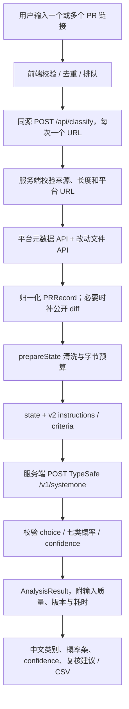

# PR 分类数据流与 API 字段（rubric v2）

核对日期：2026-10-16。本文描述当前代码的行为，而不是待实现的清洗方案。分类规则为用户提供的 `pr-seven-types-v2`，模型默认固定为 `jev-1.14.0`，两种版本相互独立。

当前也支持单次 Commit；下文原有 PR 用例和字段名继续兼容。Commit 的输入/输出差异及平台接口见第 9 节。

## 1. 数据流



批量不是把 50 个 PR 塞入一个模型请求：每批最多 50 个有效且不重复的 PR，当前页面最多并发 2 条独立的 `/api/classify` 请求，每条再发一个 TypeSafe 请求、只问一个 `choice` 问题。一个 PR 失败不终止其他条目。批次没有服务端持久队列，结果在浏览器内存中；刷新会丢失。停止按钮会停止派发及浏览器等待，已经开始的后端推理可能继续。

实现位置：`lib/batch.ts`、`lib/client-api.ts`、`lib/pr-source.ts`、`lib/classifier.ts`、`lib/rubric.ts`、`app/api/classify/route.ts`、`app/classifier-ui.tsx`、`app/batch-classifier.tsx`。

## 2. 浏览器 → 工作台 API

```http
POST /api/classify
Content-Type: application/json
X-Request-ID: <浏览器生成的 UUID>
Origin: <当前站点 origin，浏览器管理>

{"url":"https://gitee.com/dromara/warm-flow/pulls/388"}
```

| 项目 | 当前实现 |
| --- | --- |
| `url` | 唯一业务请求字段；公开 PR 的 HTTPS 链接，字符串最长 1600 字符。 |
| `X-Request-ID` | 前端生成；后端接受符合长度/字符规则的值，否则重新生成。用于错误和请求关联。 |
| `Content-Type` | 前端设置 `application/json`。 |
| `Origin` | 若请求包含 Origin，必须与工作台同源，否则在抓 PR 前返回 403。 |
| fetch 选项 | `credentials: "same-origin"`、`redirect: "manual"`、`cache: "no-store"`；这些是调用选项，不是额外的 JSON 字段。 |
| 请求大小 | 最多 4096 UTF-8 字节；只接受 POST。 |
| 服务端配置 | Worker 环境读取 `TYPESAFE_API_KEY`、`TYPESAFE_MODEL` 和各平台 token，不从浏览器 JSON 读取。 |

浏览器不会发送 Jev key、rubric、分类候选、模型版本、confidence 或复核门限。前端门限调整只影响显示，不触发重新推理。应用没有在这里存储或审核通过 PR。

## 3. 工作台 → 源平台

先验证固定域名、HTTPS、端口、无 URL 用户名密码、仓库路径和 PR 编号，然后自行拼接 API 地址，不跟随 PR 内容中的链接抓数据。请求采用 `redirect: "manual"`，单次 25 秒超时，每个源响应最多读取 6,000,000 字节。

| 平台 | 元数据 | 文件列表 | 鉴权（可选） |
| --- | --- | --- | --- |
| GitHub | `GET https://api.github.com/repos/{owner}/{repo}/pulls/{number}` | 同一路径加 `/files?per_page=100&page=1`，最多 3 页 | `Authorization: Bearer <GITHUB_TOKEN>` |
| Gitee | `GET https://gitee.com/api/v5/repos/{owner}/{repo}/pulls/{number}` | 同一路径加 `/files`，不加 GitHub 分页参数 | `?access_token=<GITEE_TOKEN>`，仅发送到 Gitee API |
| GitCode | `GET https://api.gitcode.com/api/v5/repos/{owner}/{repo}/pulls/{number}` | 同一路径加 `/files` | `Authorization: Bearer <GITCODE_TOKEN>` |
| AtomGit | `GET https://api.atomgit.com/api/v5/repos/{owner}/{repo}/pulls/{number}` | 同一路径加 `/files` | `Authorization: Bearer <ATOMGIT_TOKEN>` |

共同显式请求头：`Accept: application/json`、`User-Agent: Jev-PR-Classifier/1.0`。GitHub 的 Accept 改为 `application/vnd.github+json`，另加 `X-GitHub-Api-Version: 2022-11-28`。没有配置 token 时不加对应鉴权。Jev key 从不发到这些域名。

缺失 patch 时尝试有限大小的完整 diff。GitHub 使用同一 PR API、`Accept: application/vnd.github.diff`；其他平台使用规范化的 PR URL 加 `.diff`。GitHub 匿名 API 因访问限制失败时还可降级为公开 PR 网页 + `patch-diff.githubusercontent.com` 的 diff，且检查页面中的仓库和 PR 编号是否匹配。公开备用来源不携带 token，并强制标为需复核。此备用机制目前只针对 GitHub。

当前 GitCode 输入可识别 `/pull/{n}`，内部规范化为 `/merge_requests/{n}`；元数据及文件 API 不依赖此页面路径。若其 patch 缺失，规范化页面的 `.diff` 是否可用仍取决于平台，这是现有读取端的限制。

### 归一化映射

| 源字段 | 内部字段 | 规则 |
| --- | --- | --- |
| 已验证的提交 URL | `location.{provider,owner,repo,number,url}` | URL 查询参数、片段和尾部 files/commits/checks 视图不进入规范 URL。 |
| `title` | `title` | 转字符串；无值用“未命名 PR”。 |
| `body` / `description` | `description` | 优先 body，缺失再 description。 |
| `state` | `state` | 转字符串；缺失为 unknown。 |
| `head.sha` / `head_sha` | `headSha` | 缺失为 null。 |
| `base.sha` / `base_sha` | `baseSha` | 缺失为 null。 |
| `changed_files` / `changes_count` | `changedFiles` | 转有限数；无值用实际返回文件数。 |
| PR 顶层 `additions`、`deletions` | 同名字段 | 转有限数，否则 null，不能拿 null 当作 0。 |
| 文件 `filename` / `new_path` / `patch.new_path` / `path` / `old_path` / `patch.old_path` | `files[].path` | 按该顺序取首个非 null 值；缺失为 unknown。 |
| `status` 或 new/deleted/renamed 标记 | `files[].status` | 归一为平台 status 或 added/removed/renamed/modified。 |
| 文件 `additions`、`deletions` | `files[].additions/deletions` | 数字或数字字符串可转；否则 null。 |
| 字符串 `patch` / `diff`，或对象中的 `.diff` | `files[].patch` | 兼容 Gitee/GitCode 的对象形式。 |
| 文件数/缺失 diff 检查 | `warnings`、`diffComplete` | 保留最多 300 个文件；可能不完整或有 patch 缺失就告警并标记不完整。 |

不会读取整个仓库、clone 项目、执行测试或 PR 代码，也不会抓讨论评论、评审评论或附件。源 API 的作者资料、stars、时间线等额外字段未用于模型分类。

## 4. PRRecord → 模型 state

`prepareState` 去掉标题、描述、路径和 diff 中的部分无效控制字符；描述额外删除 `<!-- ... -->`。保留换行、代码注释、字符串、文档及示例，它们可能是判断主要目的的重要证据。

这一步**没有** AST 注释分析、恶意指令检测、语义证据提取、文件重要性排序、内容摘要或独立模型复核。v2 指令要求把所有 PR 内容视为不可信数据，但不能保证提示注入免疫。标题、路径、字符串里的伪造角色/分类命令仍可能保留，只被作为待分析材料。

发送给 Jev 的 state 字段如下：

| 字段 | 类型 | 含义 |
| --- | --- | --- |
| `pr.title` | string | 清洗后的标题。 |
| `pr.description` | string | 清洗后的描述。 |
| `pr.files` | array | 本次保留的文件列表。 |
| `pr.files[].path` | string | 路径。 |
| `pr.files[].status` | string | 文件改动类型。 |
| `pr.files[].additions/deletions` | number/null | 源平台给出的行数元数据。 |
| `pr.files[].diff` | string | 清洗后 patch，注意由内部的 `patch` 改名为 `diff`。 |
| `input_quality.total_changed_files` | number | 已知 PR 总改动文件数。 |
| `input_quality.provided_files` | number | 实际给模型的文件数。 |
| `input_quality.diff_complete` | boolean | 源和预处理后的 diff 是否认为完整。 |
| `input_quality.truncated` | boolean | 应用预算是否导致截取。 |

PR URL、平台名、head/base SHA、仓库 stars、API key、门限都不在这个 state 中。SHA 用于返回元数据和复核，不参与当前模型判断。

预算按**整个紧凑 JSON 请求**的 UTF-8 字节数计算，包括 model、state、v2 指令和全部 criteria。当前模型在 28,000 字节内走标准模式，超过则加长上下文头，应用上限为 224,000 字节。v2 指令更长，也会占这个预算；这是应用保守限制，不是 token 数或官方最大上下文。

如果超过上限，标题截到 1000 字节、描述在长模式截到 20,000 字节（不支持长模式的模型为 5000），路径截到 350 字节；必要时从尾部移除文件清单；剩余额度平均分给保留文件的 diff，并继续缩短最大 diff 直到请求合规。不会切断一个 UTF-8 字符。不是按语义挑选核心证据，可能遗漏尾部关键改动；标记 truncated 和 diff_complete=false，返回人工复核告警。

## 5. 工作台 → TypeSafe 官方 API

```http
POST https://api.typesafe.ai/v1/systemone
Content-Type: application/json
Authorization: Bearer <TYPESAFE_API_KEY>
```

| 字段 | 实际值 / 来源 |
| --- | --- |
| `model` | `TYPESAFE_MODEL` 配置值，否则 `jev-1.14.0`。 |
| `state` | 上一节的结构对象，不是单独一个 PR URL。 |
| `questions` | 只包含一个条目 `pr_category`。 |
| `questions.pr_category.type` | 固定字符串 `choice`。 |
| `questions.pr_category.instructions` | `lib/rubric.ts` 中用户提供的完整 v2 指令，不附加 PR 内容。 |
| `questions.pr_category.criteria` | 七个固定 ID 到“中文标签：完整定义”的映射。 |

criteria 的全部 key 为 `bugfix`、`feature`、`tutorial`、`test`、`refactor`、`environment`、`enhancement`。`pr_category` 是响应关联键，官方说明这个键本身不参与模型推理。`RUBRIC_VERSION` 是应用版本标识，当前只加在应用响应中，没有作为 TypeSafe 的顶层字段发送。

不发送 `messages`、`temperature`、`top_p`、`max_tokens`、confidence 门限或预期答案。概率由模型接口返回，不由通用聊天模型生成文字后解析。

长模式额外加 `TypeSafe-Danger-Zone-Long-Context: true`。标准请求 45 秒、长请求 90 秒总超时；429/529 最多尝试 3 次，重试前等待 600ms、1200ms。这个超时 signal 覆盖同一次调用的所有尝试，不是每次重置。使用 manual redirect，避免密钥跟随跳转。

官方契约及 confidence 定义：[HTTP API](https://docs.typesafe.ai/api)、[Choice](https://docs.typesafe.ai/primitives/choice)、[Confidence](https://docs.typesafe.ai/confidence)、[模型](https://docs.typesafe.ai/models)。

## 6. 详细用例：warm-flow PR #388

公开 PR：[dromara/warm-flow #388](https://gitee.com/dromara/warm-flow/pulls/388)。描述为“前端无限报错问题修复”，1 个文件、1 行增加/1 行删除；核心变更：

```diff
- v-for="(item, index) in formList" 10key="index"
+ v-for="(item, index) in formList" :key="index"
```

这是展示主改动的行内摘录，完整上下文在下面 JSON 中。参考类别是修复缺陷：修正 Vue 模板中已存在的错误属性，而不是新增用户功能。

本例从公开 Gitee API 获取真实响应，再用当前程序重建模型请求；重建过程没有调用模型、没有使用真实密钥。所有示例文件没有省略字段或用省略号替代长指令：

| 文件 | 内容 |
| --- | --- |
| [workbench-request.json](examples/warm-flow-388/workbench-request.json) | 用户提交的完整 body。 |
| [source-api-requests.json](examples/warm-flow-388/source-api-requests.json) | 当前代码会构造的两个 GET 地址、显式 headers 和超时/redirect 选项。 |
| [source-metadata.response.json](examples/warm-flow-388/source-metadata.response.json) | 真实平台元数据 API 完整 JSON。 |
| [source-files.response.json](examples/warm-flow-388/source-files.response.json) | 真实平台文件 API 完整 JSON。 |
| [pr-record.json](examples/warm-flow-388/pr-record.json) | fetchPR 的完整归一化输出。 |
| [prepared-state.json](examples/warm-flow-388/prepared-state.json) | state、质量标识、warnings、模式及字节数。 |
| [typesafe-request.json](examples/warm-flow-388/typesafe-request.json) | 实际序列化参数的可读 JSON，包含完整 v2 指令、七类定义与完整 diff。 |
| [typesafe-request-envelope.json](examples/warm-flow-388/typesafe-request-envelope.json) | URL、method、headers（密钥占位符）、body、超时及紧凑 JSON 字节数。 |
| [provenance.json](examples/warm-flow-388/provenance.json) | 采集时间与数据来源说明。 |

本例 `input_quality` 为：

```json
{
  "total_changed_files": 1,
  "provided_files": 1,
  "diff_complete": true,
  "truncated": false
}
```

当前程序构造的紧凑请求为 **10,278 UTF-8 字节**，因此 `contextMode="standard"`，不加长上下文头，`inputComplete=true`，`warnings=[]`。示例 JSON 为便于阅读缩进排版，磁盘文件大小与紧凑请求的 10,278 字节不同。

## 7. TypeSafe 响应 → 工作台响应

TypeSafe 成功响应的**结构示例**如下；这里的分布、token 数用于说明契约，不声称是本例真实推理结果。实际线上调用结果另行保存，并明确标记来源。

```json
{
  "model": "jev-1.14.0",
  "answers": {
    "pr_category": {
      "type": "choice",
      "choice": "bugfix",
      "probabilities": {
        "bugfix": 0.94,
        "feature": 0.01,
        "tutorial": 0.01,
        "test": 0.02,
        "refactor": 0.01,
        "environment": 0.005,
        "enhancement": 0.005
      },
      "confidence": 0.93
    }
  },
  "usage": { "input_tokens": 3200, "output_tokens": 30 }
}
```

| TypeSafe 字段 | 类型 / 校验 | 工作台返回字段 |
| --- | --- | --- |
| `model` | 实际使用模型；当前校验器只转字符串，不额外强制与配置一致 | `model` |
| `answers.pr_category.type` | 必须为 choice | 校验后不重复返回 type |
| `answers.pr_category.choice` | 必须是七个 ID 之一 | `choice` |
| `answers.pr_category.probabilities` | 七个 ID 的有限数，均在 [0,1]，总和与 1 相差不超过 0.02 | `probabilities`，保持原数值 |
| `answers.pr_category.confidence` | 有限数，[0,1] | `confidence`，保持原数值 |
| `usage.input_tokens` | 官方输入 token 数；当前代码原样透传 usage，不额外校验其中字段 | `usage.input_tokens` |
| `usage.output_tokens` | 官方输出 token 数 | `usage.output_tokens` |

应用当前没有检查 choice 是否确实为最大概率项，也不重算 confidence、不重归一化概率，不把 API 错误伪造成低分分类。七类 Choice 的官方公式为 `(7*p_max-1)/6`；上例 p_max=0.94，因此 confidence=0.93。0.85 的 confidence 门限相当于 p_max 约 0.87143，但两者都不等于平台上的实际正确率。

工作台响应同时附加以下**全部**字段：

| 字段 | 类型 | 来源 / 用途 |
| --- | --- | --- |
| `rubricVersion` | string | pr-seven-types-v2，服务端常量。 |
| `pr.location` | object | provider、owner、repo、number、规范化 url。 |
| `pr.title` | string | 原始归一化标题。 |
| `pr.state` | string | open/closed/merged 等源状态。 |
| `pr.headSha`、`pr.baseSha` | string/null | API 元数据；公开备用来源 baseSha 为 null。 |
| `pr.changedFiles` | number | 已知总文件数。 |
| `pr.additions`、`pr.deletions` | number/null | PR 顶层行数统计；本例这两个值为 null，单文件统计仍为 1/1。 |
| `pr.files` | array | 每个元素含 path、status、additions、deletions，**不返回 patch**。 |
| `warnings` | string[] | 来源缺失、输入截取、长上下文等提示。 |
| `inputComplete` | boolean | 输入是否完整。 |
| `contextMode` | standard/long | 由实际请求字节数与模型能力决定。 |
| `requestBytes` | number | 紧凑的 TypeSafe 请求字节数；包含 v2 规则。 |
| `elapsedMs` | number | 源读取开始至处理完成总耗时。 |
| `fetchMs` | number | 源平台读取耗时。 |
| `inferenceMs` | number | 源读取之后到完成，包含 prepareState 和 Jev 调用等，不是纯模型 GPU 时间。 |

成功响应头为 `Cache-Control: no-store`、`X-Content-Type-Options: nosniff`、`X-Request-ID: <关联编号>`，并由 Response.json 设置 JSON Content-Type。正文不返回 description、完整 diff、平台 token 或 Jev key。前端只将概率和 confidence 乘 100 格式化显示，不改变原值。

复核条件为：`inputComplete && contextMode !== "long" && confidence >= threshold`。只有同时满足才显示“达到试验门限”；其他情况建议复核。这只是显示建议，不是真正的审核提交接口。本例若取得上面的示意分布，在默认 0.85 门限下会显示“达到试验门限”。

## 8. 错误与状态探测

失败时返回安全结构，字段为 `error.code`、`error.message`、`error.stage`（request/pr_source/jev）、`error.requestId`。HTTP 状态随错误而定，例如无 key 503、模型鉴权失败 502、繁忙重试耗尽 503、非法来源 403。上游原始错误正文不传给浏览器。

```json
{
  "error": {
    "code": "JEV_REGION_UNAVAILABLE",
    "message": "TypeSafe 当前不向此服务器所在地区提供服务（HTTP 451），本次未取得分类结果。请核对 TypeSafe 的服务地区与账户可用性。",
    "stage": "jev",
    "requestId": "<本次请求编号>"
  }
}
```

浏览器连工作台的网络失败为 SITE_CONNECTION，网关登录跳转为 SITE_SIGN_IN，非 JSON 为 SITE_NON_JSON；这些与已到达服务端后返回的 SOURCE_* / JEV_* 区分。不能只凭 “Failed to fetch” 判断 Jev 是否调用成功。

页面的 `/api/status` 会使用同一个模型接口发一个独立的极小 noul 可用性问题，并在同一 Worker isolate 内缓存 60 秒；它会消耗少量 tokens，但不读取当前 PR，也不参与七类概率。其完整请求构造见 `lib/service-status.ts`，不要把它的成功当作某个 PR 分类成功。

状态请求链为浏览器 `GET /api/status`（无 body）→ 服务端 `POST https://api.typesafe.ai/v1/systemone`。后者用相同的 Content-Type/Bearer 头、manual redirect、25 秒超时，不加长上下文头，也不使用七类 rubric：

```json
{
  "model": "jev-1.14.0",
  "state": "The service is ready.",
  "questions": {
    "availability_check": {
      "type": "noul",
      "instructions": "Does the text say the service is ready?"
    }
  }
}
```

它校验官方响应中的 `model`、`answers.availability_check.type="noul"`、`answers.availability_check.noul`（[0,1] 有限数），且在固定版本配置下要求响应模型版本相符。状态接口向浏览器返回以下字段：

| 字段 | 含义 |
| --- | --- |
| `ready` | 是否配置 key，仅代表配置存在。 |
| `model` | 配置的模型或默认模型。 |
| `verifiedModel` | 可选，仅成功校验真实响应后包含。 |
| `availability` | reachable / unavailable / not_configured。 |
| `code` | 如 JEV_INFERENCE_VERIFIED、KEY_NOT_CONFIGURED、JEV_CONNECTION、JEV_AUTH 等。 |
| `message` | 对用户的安全说明。 |
| `upstreamStatus` | 可选，实际收到 TypeSafe HTTP 响应后包含状态码。 |

状态 API 使用 `Cache-Control: no-store`，成功或失败的可用性判断都通过这个对象表达；不能只检查浏览器收到的 HTTP 200 就认为模型可用。

## 9. Commit 贡献地址

浏览器仍提交 `POST /api/classify`，body 为 `{ "url": "https://github.com/apache/rocketmq-dashboard/commit/baf70ae6a759570110dce9a1973dc617433492dc" }`。PR 和 Commit 可以混合排队。

| 平台 | 提交元数据 / 文件 | 补充 diff |
| --- | --- | --- |
| GitHub | `GET /repos/{owner}/{repo}/commits/{sha}?per_page=100&page=1`，从响应的 files 读取并分页 | 同一提交 API，Accept 为 application/vnd.github.diff |
| Gitee | `GET /api/v5/repos/{owner}/{repo}/commits/{sha}`，files 含文件及 patch | 公开 `/commit/{sha}.diff`，若失败则明确标注证据缺失 |
| GitCode / AtomGit | `GET /api/v5/repos/{owner}/{repo}/commits/{sha}?show_diff=true` | `GET /api/v5/repos/{owner}/{repo}/commit/{sha}/diff`，注意单数 commit |

元数据响应中的完整 `sha` 必须匹配输入 SHA 前缀；后续分页和 diff 请求固定使用解析出的完整 SHA。不会把用户输入当成分支名，也不会读取关联 PR 来替换提交范围。源 token 仍仅发给所属平台 API。

提交说明首行映射到 `pr.title`，完整说明映射到 `pr.description`，`parents[0].sha` 为 `baseSha`，提交 sha 为 `headSha`，`stats.additions/deletions` 为顶层统计。合并提交以第一父提交比较，初始提交 baseSha=null、与空树比较。

Jev 的 `state.pr` 额外包含 `source_type="commit"`、`comparison`（first-parent / empty-tree / unknown）、`parent_count`（可能为 null）。问题仍名为 pr_category、类型 choice、七类 criteria 仍为用户提供的 v2；仅在完整 v2 指令前附加单次提交范围说明。输入预算包含这段附加指令。

响应保留原有 `pr` 字段以兼容调用方：`pr.location.kind="commit"`，包含 `sha`，不伪造 number。PR 对象为 kind=pr 且包含 number。Commit 还返回 parentShas 和 comparison。来源 API 受限时可降级为 GitHub 公开 .patch，核验 patch 内 SHA，并将基准标 unknown、inputComplete=false，强制建议复核。

批量 CSV 首列为“贡献链接”，增加“对象类型”“提交SHA或PR编号”“比较基准”字段。两种输入都沿用每批 50 条和并发 2 条限制。不要把一个 commit 的类别直接当作其关联完整 PR 的类别。

示例 RocketMQ Dashboard 提交已实读到 3 个改动文件，说明标题为“fix(metrics): retain newest queries when history responses finish out of order (#6377)”。即使说明提到 #6377，分类输入也只包括该 SHA 的内容。此源数据读取验证不等于已经取得模型推理结果。
